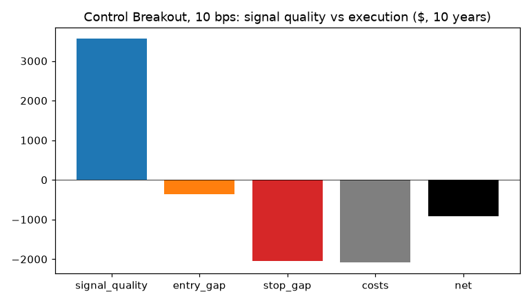
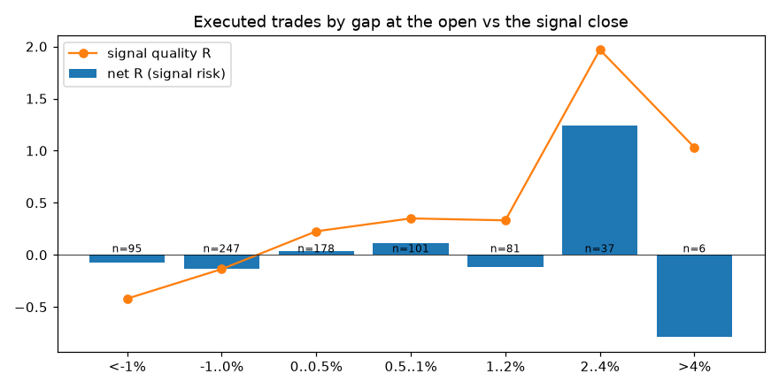
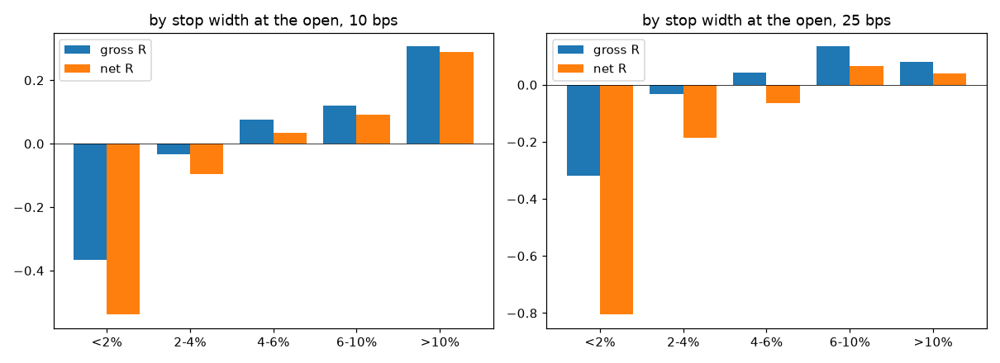
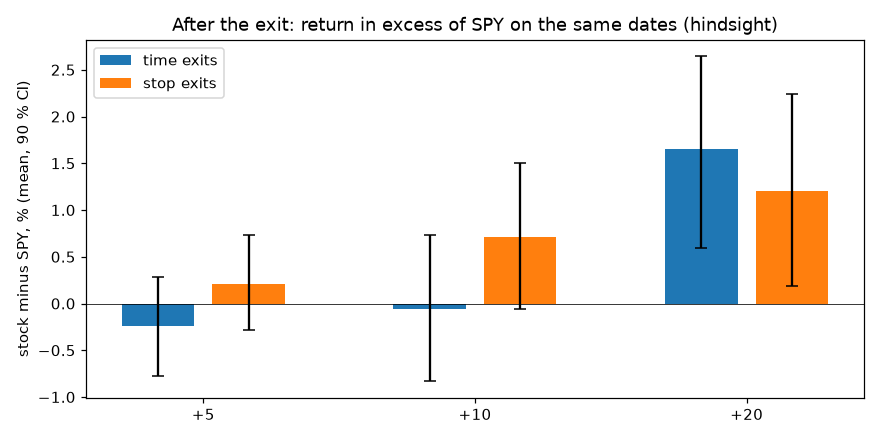
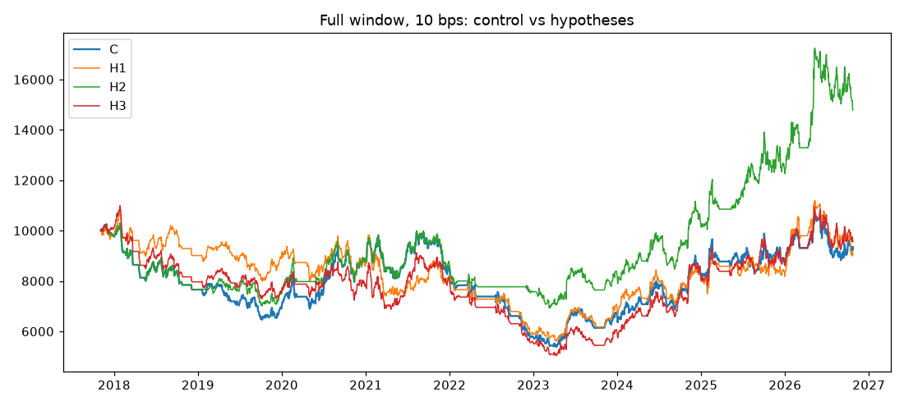
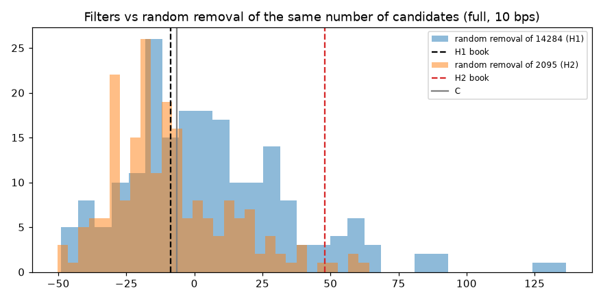

# Why research Breakout is weak — execution audit and hypotheses (exploratory)

Pre-registration: `research/breakout_causes/PREREG_BREAKOUT_CAUSES.md`. The 2017–2026 data were already examined (PR #19, #22): nothing here is independent confirmation. Research Breakout enters at the next open (not the bot's pre-close breakout). No paper book is started.

## Reproduction gate

Control C reproduces PR #19: 10 bps: exact; 25 bps: exact

## 1. Execution audit (control C, Breakout)

Exact split of net P&L into signal quality (exit at the planned stop or the time-exit close, measured from the signal-day close) and execution mechanics. R is per trade on the risk at the signal close.

| Set | n | Signal quality | Entry gap | Stop gap | Costs | Net |
|---|---:|---:|---:|---:|---:|---:|
| executed_10bps ($) | 745 | 3,561 | -358 | -2,050 | -2,077 | -924 |
| executed_10bps (R/trade) | 745 | +0.145 | -0.037 | -0.045 | -0.048 | +0.014 |
| executed_25bps ($) | 747 | 1,704 | -178 | -1,721 | -4,233 | -4,429 |
| executed_25bps (R/trade) | 747 | +0.120 | -0.033 | -0.050 | -0.121 | -0.085 |
| all_candidates_10bps (R/trade) | 26802 | +0.092 | -0.022 | -0.033 | -0.051 | -0.013 |
| non_overlap_10bps (R/trade) | 8180 | +0.104 | -0.025 | -0.031 | -0.049 | -0.000 |

- Open gap vs the signal close (executed): median +0.10 %, mean +0.13 %; 54 % of entries opened above the signal close; mean gap +0.037 R of the signal risk.
- Candidates never traded because the open was at or below the stop: 152 of 27080 eligible signals.
- Entry-day stops (executed): 62 trades, $-3,286, mean -0.84 R; 74 % of them had a risk < 4 % at the open.

| Open gap | n | Signal quality R | Entry gap R | Net R | Stop rate | Entry-day stop rate |
|---|---:|---:|---:|---:|---:|---:|
| <-1% | 95 | -0.420 | +0.406 | -0.075 | 0.79 | 0.28 |
| -1..0% | 247 | -0.137 | +0.091 | -0.135 | 0.66 | 0.09 |
| 0..0.5% | 178 | +0.226 | -0.066 | +0.040 | 0.61 | 0.02 |
| 0.5..1% | 101 | +0.350 | -0.172 | +0.115 | 0.54 | 0.02 |
| 1..2% | 81 | +0.331 | -0.334 | -0.112 | 0.59 | 0.07 |
| 2..4% | 37 | +1.969 | -0.642 | +1.237 | 0.49 | 0.03 |
| >4% | 6 | +1.031 | -1.516 | -0.789 | 0.67 | 0.00 |

| Risk at the open | bps | n | Gross R | Cost R | Net R | Stop rate | Entry-day stop rate |
|---|---|---:|---:|---:|---:|---:|---:|
| <2% | 10 | 28 | -0.367 | 0.172 | -0.539 | 0.93 | 0.46 |
| 2-4% | 10 | 312 | -0.033 | 0.062 | -0.095 | 0.69 | 0.11 |
| 4-6% | 10 | 259 | +0.077 | 0.042 | +0.035 | 0.62 | 0.05 |
| 6-10% | 10 | 120 | +0.119 | 0.028 | +0.091 | 0.50 | 0.03 |
| >10% | 10 | 26 | +0.307 | 0.017 | +0.290 | 0.35 | 0.04 |
| <2% | 25 | 26 | -0.318 | 0.487 | -0.805 | 0.92 | 0.46 |
| 2-4% | 25 | 314 | -0.031 | 0.155 | -0.187 | 0.69 | 0.10 |
| 4-6% | 25 | 267 | +0.042 | 0.105 | -0.063 | 0.63 | 0.04 |
| 6-10% | 25 | 116 | +0.135 | 0.070 | +0.065 | 0.48 | 0.02 |
| >10% | 25 | 24 | +0.080 | 0.041 | +0.039 | 0.33 | 0.00 |

## 2. After the exit: stock vs SPY on the same dates (hindsight)

| Exit | Horizon | n | Stock % | SPY % | Excess % (mean) | Excess median | Excess > 0 | 90 % CI of mean excess |
|---|---|---:|---:|---:|---:|---:|---:|---|
| stop | +5 | 469 | +0.45 | +0.24 | +0.21 | +0.19 | 52 % | [-0.28, +0.74] |
| stop | +10 | 465 | +1.09 | +0.38 | +0.71 | +0.23 | 51 % | [-0.06, +1.50] |
| stop | +20 | 461 | +1.92 | +0.72 | +1.20 | +1.14 | 54 % | [+0.19, +2.24] |
| time | +5 | 274 | +0.20 | +0.45 | -0.24 | -0.28 | 47 % | [-0.78, +0.28] |
| time | +10 | 273 | +0.24 | +0.30 | -0.05 | +0.09 | 50 % | [-0.83, +0.73] |
| time | +20 | 269 | +2.28 | +0.63 | +1.66 | +1.01 | 55 % | [+0.59, +2.65] |

## 3. Hypotheses: full portfolio replays

| Book | Window | bps | Return | CAGR | Max DD | PF | Trades | Exp. R |
|---|---|---|---:|---:|---:|---:|---:|---:|
| C | full | 10 | -6.5 % | -0.7 % | -47.7 % | 0.97 | 750 | -0.023 |
| C | full | 25 | -43.1 % | -6.1 % | -56.3 % | 0.84 | 752 | -0.118 |
| C | first_half | 10 | -15.3 % | -3.9 % | -37.2 % | 0.89 | 357 | -0.077 |
| C | first_half | 25 | -27.8 % | -7.5 % | -42.0 % | 0.81 | 354 | -0.137 |
| C | second_half | 10 | +22.6 % | +4.3 % | -35.9 % | 1.10 | 399 | +0.057 |
| C | second_half | 25 | -7.3 % | -1.6 % | -38.9 % | 0.95 | 398 | -0.066 |
| H1 | full | 10 | -8.8 % | -1.0 % | -47.8 % | 0.97 | 660 | -0.000 |
| H1 | full | 25 | -34.0 % | -4.5 % | -55.9 % | 0.87 | 665 | -0.069 |
| H1 | first_half | 10 | -19.1 % | -5.0 % | -31.2 % | 0.87 | 322 | -0.069 |
| H1 | first_half | 25 | -30.4 % | -8.3 % | -39.5 % | 0.79 | 322 | -0.126 |
| H1 | second_half | 10 | +27.8 % | +5.2 % | -31.8 % | 1.13 | 336 | +0.099 |
| H1 | second_half | 25 | +3.2 % | +0.7 % | -34.2 % | 1.01 | 339 | +0.026 |
| H2 | full | 10 | +47.8 % | +4.5 % | -32.7 % | 1.14 | 690 | +0.101 |
| H2 | full | 25 | -3.1 % | -0.3 % | -42.5 % | 0.98 | 686 | -0.009 |
| H2 | first_half | 10 | -13.4 % | -3.4 % | -31.8 % | 0.90 | 335 | -0.014 |
| H2 | first_half | 25 | -25.6 % | -6.9 % | -37.1 % | 0.82 | 334 | -0.082 |
| H2 | second_half | 10 | +60.0 % | +10.3 % | -19.9 % | 1.25 | 361 | +0.170 |
| H2 | second_half | 25 | +41.7 % | +7.5 % | -22.0 % | 1.20 | 360 | +0.108 |
| H3 | full | 10 | -4.3 % | -0.5 % | -54.2 % | 0.98 | 696 | -0.015 |
| H3 | full | 25 | -40.0 % | -5.5 % | -63.6 % | 0.84 | 707 | -0.125 |
| H3 | first_half | 10 | -19.8 % | -5.2 % | -37.5 % | 0.85 | 332 | -0.107 |
| H3 | first_half | 25 | -34.1 % | -9.6 % | -46.0 % | 0.75 | 332 | -0.185 |
| H3 | second_half | 10 | +24.0 % | +4.6 % | -37.1 % | 1.13 | 366 | +0.075 |
| H3 | second_half | 25 | +8.9 % | +1.8 % | -40.1 % | 1.05 | 364 | +0.016 |

- H1: removing 14284 random candidates (200 seeds), full 10 bps return p20 / p50 / p80 / p95 = -17.8 / +1.4 / +28.8 / +61.7 %; H1 = -8.8 %.
- H2: removing 2095 random candidates (200 seeds), full 10 bps return p20 / p50 / p80 / p95 = -28.1 / -12.9 / +9.0 / +31.4 %; H2 = +47.8 %.

H3 changed 6035 of 11169 time exits (strong at bar 20): {'trail': 5981, 'time60': 44, 'open': 10}.

## Decision (pre-registered, applied unchanged)

| Hypothesis | Criteria | Verdict |
|---|---|---|
| H1 | full return > C at 10 and 25: no; full PF > C at 10 and 25: no; max DD not > 3 pt deeper (10): yes; both halves return > C (10): no; > random-removal p80 (full 10): no | **not supported** |
| H2 | full return > C at 10 and 25: yes; full PF > C at 10 and 25: yes; max DD not > 3 pt deeper (10): yes; both halves return > C (10): yes; > random-removal p80 (full 10): yes | **supported (exploratory)** |
| H3 | full return > C at 10 and 25: yes; full PF > C at 10 and 25: no; max DD not > 3 pt deeper (10): no; both halves return > C (10): no | **not supported** |

Even a 'supported' verdict only makes a candidate for a separately approved forward paper test.

