# Breakout + MA200 — Quality & Exit Study v1 (exploratory)

Pre-registration: `research/breakout_ma200/PREREG_MA200_QE.md` (committed before any calculation). The ten years were already examined (PR #19, #22): **nothing here confirms a strategy**; only a future independent forward test can. Research Breakout buys at the **next session's open** — this is **not** a test of `trader.py`'s pre-close purchases. No paper book is started.

## Checks

- Reproduction of PR #19 variant M (tolerance 1e-6, trade count equal): {'full 10 bps': 'exact', 'full 25 bps': 'exact', 'y2017_2021 10 bps': 'exact', 'y2017_2021 25 bps': 'exact', 'y2022_2026 10 bps': 'exact', 'y2022_2026 25 bps': 'exact'}
- Next-open execution: 0 violations in 24833 M candidates (entry = the stock's next session open after the signal).
- No look-ahead (detection cut at 2021-12-31, entries to 2021-11-30): {'candidates_truncated': 11421, 'candidates_full': 11421, 'identical': True}.
- Money reconciliation M 10 bps: {'profit_usd': 4784.209, 'realized_net_usd': 5023.8058, 'open_unrealized_on_curve_usd': -239.5969, 'residual_usd': 0.0, 'matches_cent': True, 'cash_residual_usd': 0.0, 'cash_matches_cent': True}.
- Former members without any price history: 117 of 726; PIT member-days without a price by year (mean share): 2017: 20.6 %, 2018: 18.8 %, 2019: 16.1 %, 2020: 12.9 %, 2021: 11.0 %, 2022: 8.4 %, 2023: 5.8 %, 2024: 4.3 %, 2025: 3.0 %, 2026: 1.1 %. Their effect on returns cannot be measured (survivorship); it is a limitation of every number below.

## Stage 1 — diagnostic of control M (from M's own trades)

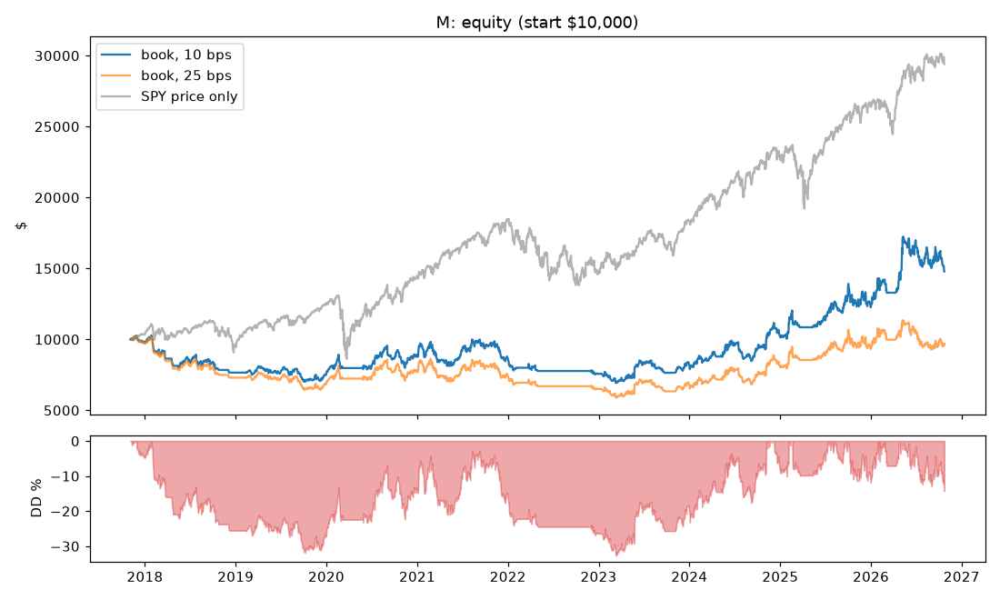

| Component | $ |
|---|---:|
| gross price P&L, time exits | 40,108.64 |
| gross price P&L, stop exits at the planned stop | -30,594.73 |
| extra loss: gaps through the stop | -2,163.91 |
| costs on closed trades | -2,326.19 |
| open positions at the end (mark, after entry fee) | -239.60 |
| total = final equity - initial | 4,784.21 |

Closed trades 686: win rate 33.7 %, mean +0.101 R (avg win +2.43 R, avg loss -1.08 R), PF 1.14; gross +0.158 R, costs 0.056 R per trade.

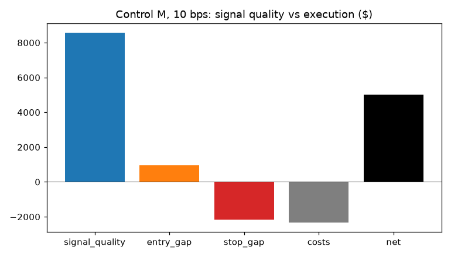

| Exact split (risk at the signal close) | Signal quality | Entry gap | Stop gap | Costs | Net |
|---|---:|---:|---:|---:|---:|
| executed, 10 bps ($) | 8,564 | 950 | -2,164 | -2,326 | 5,024 |
| executed, 10 bps (R/trade) | +0.255 | -0.028 | -0.045 | -0.049 | +0.133 |
| executed, 25 bps ($) | 5,908 | 75 | -1,858 | -4,721 | -596 |
| executed, 25 bps (R/trade) | +0.219 | -0.030 | -0.046 | -0.121 | +0.022 |

### Exits

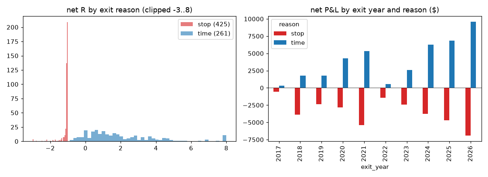

| Reason | Trades | Net P&L | Mean R | Win % | MFE R |
|---|---:|---:|---:|---:|---:|
| stop | 425 | $-34,236 | -1.133 | 0.0 | 1.00 |
| time | 261 | $39,260 | +2.111 | 88.5 | 3.31 |

- Entry-day stops 52; stops that had been ≥ +1 R before the exit day 103; gaps through the stop 56 (extra $-2,164).
- Time exits: mean MFE 3.31 R, kept +2.11 R.

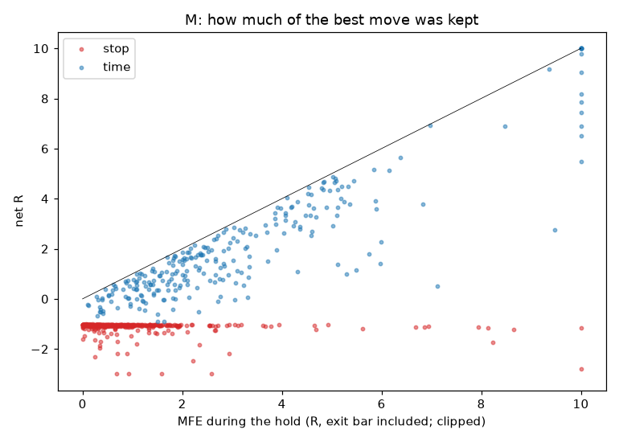

| After the exit vs SPY (hindsight) | Horizon | n | Stock % | SPY % | Excess mean | Excess > 0 | 90 % CI |
|---|---|---:|---:|---:|---:|---:|---|
| stop | +5 | 423 | +0.25 | +0.18 | +0.07 | 49 % | [-0.44, +0.62] |
| stop | +10 | 419 | +0.89 | +0.33 | +0.56 | 51 % | [-0.20, +1.38] |
| stop | +20 | 414 | +1.87 | +0.79 | +1.08 | 54 % | [+0.02, +2.13] |
| time | +5 | 261 | +0.05 | +0.36 | -0.31 | 51 % | [-0.90, +0.25] |
| time | +10 | 261 | +0.09 | +0.36 | -0.27 | 49 % | [-1.08, +0.55] |
| time | +20 | 256 | +1.22 | +0.62 | +0.60 | 50 % | [-0.48, +1.68] |

### Entry quality, RS, concentration

| Group | Value | Trades | Mean R | Win % | P&L |
|---|---|---:|---:|---:|---:|
| rs_bucket | 85-89 | 31 | -0.364 | 32.3 | $-906 |
| rs_bucket | 90-94 | 93 | -0.034 | 34.4 | $-968 |
| rs_bucket | 95-99 | 562 | +0.150 | 33.6 | $6,898 |
| risk_bucket | <2% | 33 | +0.038 | 12.1 | $-95 |
| risk_bucket | 2-4% | 286 | +0.052 | 29.4 | $86 |
| risk_bucket | 4-6% | 238 | +0.094 | 35.7 | $1,669 |
| risk_bucket | 6-10% | 101 | +0.217 | 43.6 | $2,169 |
| risk_bucket | >10% | 28 | +0.329 | 50.0 | $1,195 |
| cohort | 2017-2021 | 335 | -0.029 | 32.5 | $-1,898 |
| cohort | 2022-2026 | 351 | +0.226 | 34.8 | $6,921 |

Top 10 winners $8,761; without them $-3,737 (arithmetic). Trades ≥ 3 R: 62 ($24,150).

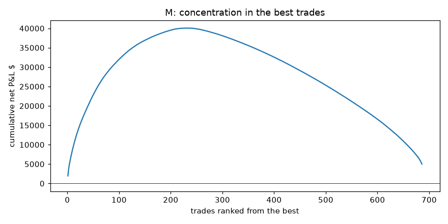

| Funnel | Count | Mean R | Win % |
|---|---:|---:|---:|
| all_candidates | 24833 | -0.028 | 35.3 |
| non_overlap_model_trades | 7630 | -0.027 | 36.0 |
| portfolio_closed | 686 | +0.101 | 33.7 |

| Portfolio decision | Count | Hypothetical mean R |
|---|---:|---:|
| capital_or_risk | 6 | +0.077 |
| daily_entries | 662 | +0.143 |
| entered | 690 | +0.101 |
| positions | 21895 | -0.048 |
| ticker_open | 1580 | +0.108 |

Capital: invested 58.9 % on average, 3.39 positions, fully in cash 20.3 % of sessions, all slots full 46.7 %.

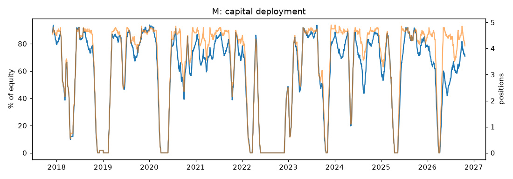

### Years, and 2018 / 2019 / 2021 in detail

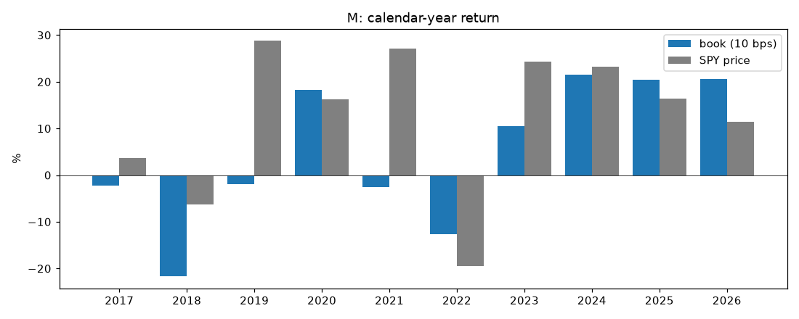

| Year | M | SPY price | Exits | Win % | Mean R |
|---|---:|---:|---:|---:|---:|
| 2017 | -2.2 % | +3.6 % | 11 | 27.3 | -0.231 |
| 2018 | -21.7 % | -6.3 % | 72 | 25.0 | -0.476 |
| 2019 | -1.9 % | +28.8 % | 71 | 32.4 | +0.044 |
| 2020 | +18.3 % | +16.2 % | 72 | 43.1 | +0.405 |
| 2021 | -2.5 % | +27.0 % | 104 | 32.7 | -0.000 |
| 2022 | -12.6 % | -19.5 % | 24 | 16.7 | -0.543 |
| 2023 | +10.5 % | +24.3 % | 69 | 36.2 | +0.062 |
| 2024 | +21.6 % | +23.3 % | 90 | 42.2 | +0.424 |
| 2025 | +20.5 % | +16.4 % | 85 | 32.9 | +0.307 |
| 2026 | +20.6 % | +11.4 % | 88 | 30.7 | +0.212 |

**2018 by month** (book %, stops/exits, P&L, invested %): 1: +2.1 % (2/5, $-20, 89 %); 2: -8.5 % (9/10, $-638, 46 %); 3: -5.4 % (8/9, $-440, 48 %); 4: -5.9 % (7/7, $-508, 11 %); 5: +1.4 % (3/3, $-185, 61 %); 6: +2.6 % (2/6, $388, 86 %); 7: -1.4 % (1/4, $120, 90 %); 8: +1.5 % (4/10, $24, 78 %); 9: -1.1 % (3/5, $-178, 77 %); 10: -6.3 % (8/10, $-457, 41 %); 11: +0.0 % (0/0, $0, 0 %); 12: -2.4 % (3/3, $-185, 2 %)

**2019 by month** (book %, stops/exits, P&L, invested %): 1: +0.0 % (0/0, $0, 0 %); 2: +1.8 % (2/2, $-99, 52 %); 3: +2.3 % (3/5, $44, 86 %); 4: -1.5 % (4/9, $130, 82 %); 5: -2.6 % (3/7, $-136, 71 %); 6: -0.8 % (3/4, $-20, 66 %); 7: +1.7 % (3/8, $237, 89 %); 8: +2.7 % (4/6, $-159, 73 %); 9: -9.4 % (10/13, $-441, 74 %); 10: -0.3 % (5/6, $-151, 84 %); 11: +1.7 % (2/6, $-24, 92 %); 12: +3.2 % (2/5, $24, 90 %)

**2021 by month** (book %, stops/exits, P&L, invested %): 1: -1.7 % (9/14, $276, 71 %); 2: +7.8 % (2/4, $164, 73 %); 3: -10.8 % (14/17, $-530, 63 %); 4: -3.1 % (4/8, $-159, 72 %); 5: +1.9 % (5/6, $-288, 80 %); 6: +10.5 % (2/6, $391, 85 %); 7: +0.6 % (3/8, $604, 79 %); 8: +5.9 % (2/7, $506, 76 %); 9: -4.0 % (6/9, $-228, 69 %); 10: +1.9 % (0/2, $314, 59 %); 11: -4.1 % (10/13, $-441, 79 %); 12: -5.6 % (9/10, $-671, 74 %)

Control-C candidates removed by the MA200 filter (hypothetical net R at 10 bps, by signal year): 2019: n=386, +0.752 R, 69 % wins; 2020: n=333, -0.070 R, 32 % wins; 2022: n=1154, -0.295 R, 30 % wins; 2023: n=88, +0.028 R, 38 % wins; 2025: n=134, +0.779 R, 52 % wins

## Stages 2–3 — hypotheses A and B (independent full replays)

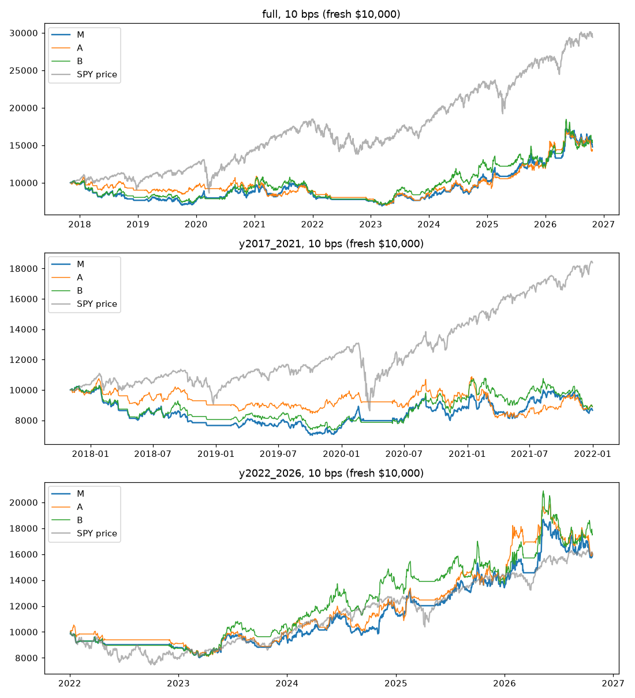

| Book | Window | bps | Return | CAGR | Max DD | PF | Exp. R | Win % | Trades | Turnover/yr | Invested % |
|---|---|---|---:|---:|---:|---:|---:|---:|---:|---:|---:|
| M | full | 10 | +47.8 % | +4.5 % | -32.7 % | 1.14 | +0.101 | 33.7 | 690 | 27.9× | 59 |
| M | full | 25 | -3.1 % | -0.3 % | -42.5 % | 0.98 | -0.009 | 32.9 | 686 | 26.9× | 59 |
| M | full | 50 | -53.7 % | -8.2 % | -58.7 % | 0.78 | -0.186 | 31.3 | 692 | 26.3× | 58 |
| M | y2017_2021 | 10 | -13.4 % | -3.4 % | -31.8 % | 0.90 | -0.014 | 33.0 | 335 | 28.6× | 64 |
| M | y2017_2021 | 25 | -25.6 % | -6.9 % | -37.1 % | 0.82 | -0.082 | 32.8 | 334 | 28.5× | 64 |
| M | y2017_2021 | 50 | -42.6 % | -12.5 % | -44.6 % | 0.69 | -0.196 | 32.3 | 333 | 28.1× | 64 |
| M | y2022_2026 | 10 | +60.0 % | +10.3 % | -19.9 % | 1.25 | +0.170 | 34.3 | 361 | 27.2× | 54 |
| M | y2022_2026 | 25 | +41.7 % | +7.5 % | -22.0 % | 1.20 | +0.108 | 33.1 | 360 | 27.0× | 54 |
| M | y2022_2026 | 50 | +4.3 % | +0.9 % | -25.1 % | 1.01 | -0.056 | 32.2 | 359 | 25.8× | 54 |
| A | full | 10 | +44.0 % | +4.1 % | -36.0 % | 1.12 | +0.090 | 38.4 | 597 | 22.3× | 56 |
| A | full | 25 | +4.2 % | +0.5 % | -45.5 % | 1.01 | +0.022 | 37.5 | 601 | 22.3× | 56 |
| A | full | 50 | -26.2 % | -3.3 % | -54.8 % | 0.89 | -0.054 | 37.0 | 602 | 22.0× | 56 |
| A | y2017_2021 | 10 | -11.0 % | -2.8 % | -25.0 % | 0.92 | -0.032 | 37.2 | 301 | 24.3× | 61 |
| A | y2017_2021 | 25 | -23.7 % | -6.3 % | -32.9 % | 0.83 | -0.090 | 36.8 | 301 | 24.1× | 61 |
| A | y2017_2021 | 50 | -35.7 % | -10.1 % | -41.2 % | 0.74 | -0.164 | 36.5 | 298 | 23.6× | 61 |
| A | y2022_2026 | 10 | +61.0 % | +10.4 % | -23.1 % | 1.28 | +0.213 | 39.5 | 300 | 20.8× | 52 |
| A | y2022_2026 | 25 | +44.9 % | +8.0 % | -24.7 % | 1.21 | +0.167 | 39.5 | 298 | 20.6× | 52 |
| A | y2022_2026 | 50 | +14.5 % | +2.9 % | -27.2 % | 1.07 | +0.074 | 38.4 | 298 | 20.1× | 52 |
| B | full | 10 | +53.9 % | +4.9 % | -34.4 % | 1.16 | +0.110 | 34.0 | 616 | 24.7× | 61 |
| B | full | 25 | +21.0 % | +2.2 % | -40.2 % | 1.06 | +0.040 | 33.7 | 617 | 24.6× | 61 |
| B | full | 50 | -39.9 % | -5.5 % | -55.5 % | 0.83 | -0.152 | 32.3 | 622 | 24.2× | 60 |
| B | y2017_2021 | 10 | -11.1 % | -2.8 % | -28.6 % | 0.91 | -0.007 | 31.5 | 307 | 26.5× | 66 |
| B | y2017_2021 | 25 | -22.5 % | -6.0 % | -33.8 % | 0.83 | -0.076 | 31.2 | 306 | 26.3× | 66 |
| B | y2017_2021 | 50 | -40.8 % | -11.9 % | -43.0 % | 0.70 | -0.208 | 30.9 | 306 | 26.1× | 66 |
| B | y2022_2026 | 10 | +75.6 % | +12.4 % | -20.7 % | 1.36 | +0.227 | 36.7 | 313 | 23.5× | 56 |
| B | y2022_2026 | 25 | +49.8 % | +8.8 % | -22.9 % | 1.24 | +0.131 | 35.9 | 314 | 23.4× | 56 |
| B | y2022_2026 | 50 | +15.8 % | +3.1 % | -23.9 % | 1.07 | -0.003 | 35.0 | 317 | 23.1× | 56 |

| SPY price only | Window | Return | CAGR | Max DD | Invested |
|---|---|---:|---:|---:|---:|
| SPY | full | +195.0 % | +12.8 % | -34.1 % | 100 % |
| SPY | y2017_2021 | +84.4 % | +15.8 % | -34.1 % | 100 % |
| SPY | y2022_2026 | +60.0 % | +10.3 % | -25.4 % | 100 % |

The books risk 1 % per trade with at most 5 positions and are invested only part of the time (see Invested %), so their return and drawdown are not comparable one-to-one with a fully invested SPY; SPY is price only (no dividends), and the books earn no cash interest.

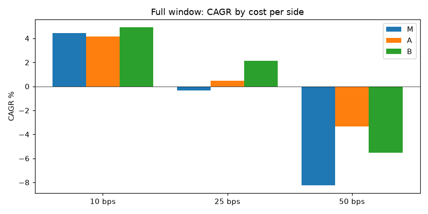

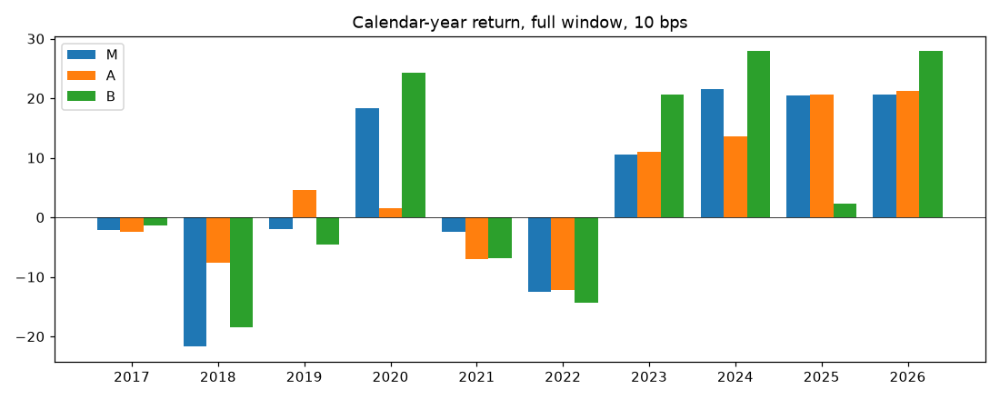

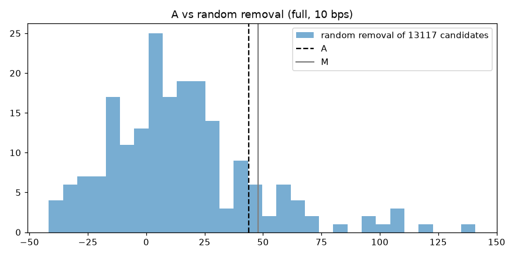

A removed 13117 of 24833 candidates. Random removal of the same number (200 seeds, full 10 bps): p20 / p50 / p80 / p95 = -11.7 / +11.6 / +32.4 / +68.3 %.

B: 2934 of 10230 time exits had ≥ +2 R at day 20 and became runners; exits {'runner_stop': 2696, 'runner_time40': 232, 'open': 6}; candidate-level mean R at the runner exit +3.66 vs +3.74 at day 20 (candidate level, not portfolio). Skips 'positions' full 10 bps: M 21895, B 21887.

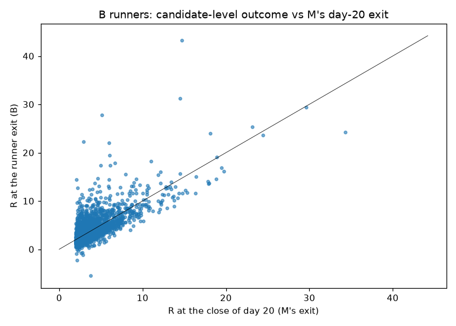

## Decision (pre-registered, applied unchanged)

| Hypothesis | Criteria | Verdict |
|---|---|---|
| A | CAGR > M full at 10 and 25: no; PF > M full at 10 and 25: no; max DD not > 3 pt deeper (full 10): no; CAGR > M in 2017-2021 and 2022-2026 (10): yes; return > random-removal p80 (full 10): yes | **not supported** |
| B | CAGR > M full at 10 and 25: yes; PF > M full at 10 and 25: yes; max DD not > 3 pt deeper (full 10): yes; CAGR > M in 2017-2021 and 2022-2026 (10): yes | **supported (exploratory)** |

Even a 'supported' verdict is only a candidate for a separately approved forward test. A+B was not tested.

