# Long Breakout / Retest — ten-year diagnostic (exploratory)

Baseline C of PR #19 only (PIT S&P 500, RS ≥ 85, SPY > MA50, entry at the next open, stop = base × 0.97, exit by stop or at the close of the 20th bar, 1 % risk, 5 positions, 3 a day, 20 % cap, $10,000, RS-first). The ten years were already examined in PR #19: this is **not** independent validation. Research Breakout enters at the **next-session open**, unlike `trader.py` pre-close buys.

Window 2017-11-03 → 2026-10-23. Dataset SHA-256: `{"bars.pkl.gz": "98a68ab735d3a2535bdec6aaa22b152a68e9d30f1d94d19cb83524e95b4650ab", "sp500_pit_fja05680.csv": "36326709d46d6cd25834de5df457b16f5f96fad3a06b9beac28f7b88aa0b0d54"}`.

## 1. Baseline reproduced (fail-closed)

| Book | Return | Max DD | Executed | Closed | Open at end | P&L reconciled to the cent | PR #19 |
|---|---:|---:|---:|---:|---:|---|---|
| breakout / 10 bps per side | -6.51 % | -47.66 % | 750 | 745 | 5 | True (residual $-0.0000) | matched |
| breakout / 25 bps per side | -43.07 % | -56.30 % | 752 | 747 | 5 | True (residual $0.0000) | matched |
| retest / 10 bps per side | 1.26 % | -48.05 % | 592 | 588 | 4 | True (residual $-0.0000) | matched |
| retest / 25 bps per side | -20.06 % | -53.82 % | 597 | 593 | 4 | True (residual $0.0000) | matched |

No-look-ahead check (detection on data truncated at 2021-12-31, entries to 2021-11-30): breakout: True (12140 candidates), retest: True (5919 candidates)

## Breakout (10 bps book)

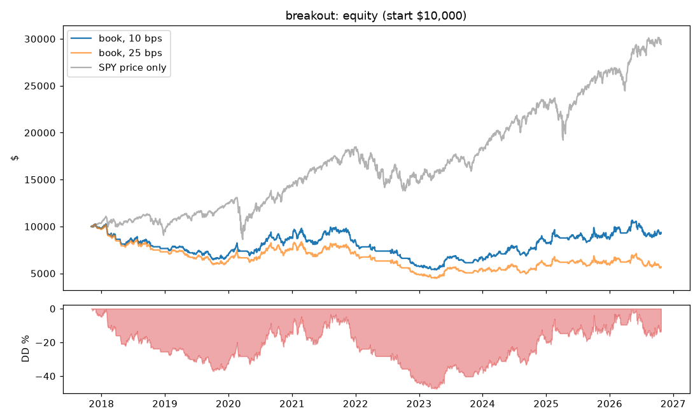

### Where the ten-year result comes from (exact $ decomposition)

| Component | $ |
|---|---:|
| gross price P&L, time exits | 31,545.03 |
| gross price P&L, stop exits at the planned stop | -28,341.84 |
| extra loss: gaps through the stop | -2,049.74 |
| costs on closed trades | -2,077.10 |
| open positions at the end (mark, after entry fee) | 272.78 |
| total = final equity - initial | -650.88 |

Closed trades 745: win rate 31.7 %, mean -0.023 R (avg win +2.23 R, avg loss -1.07 R), PF 0.97. Gross mean +0.029 R, costs 0.052 R per trade. Dividends a holder would have received but the engine does not credit: $549.

### Candidate funnel (hypothetical R only for comparison, never added to P&L)

| Set | Count | Mean R | Win % | PF (R) |
|---|---:|---:|---:|---:|
| all_candidates | 26928 | -0.025 | 35.6 | 0.96 |
| non_overlap_model_trades | 8223 | -0.016 | 36.4 | 0.97 |
| portfolio_closed | 745 | -0.023 | 31.7 | 0.97 |

| Portfolio decision | Count | Hypothetical mean R |
|---|---:|---:|
| capital_or_risk | 10 | +0.462 |
| daily_entries | 745 | +0.191 |
| entered | 750 | -0.023 |
| positions | 23734 | -0.042 |
| ticker_open | 1689 | +0.108 |

### Exits

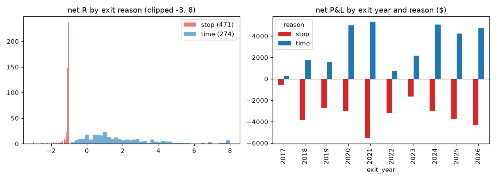

| Reason | Trades | Net P&L | Mean R | Win % | PF | MFE R (mean) |
|---|---:|---:|---:|---:|---:|---:|
| stop | 471 | $-31,720 | -1.125 | 0.0 | 0.00 | 0.90 |
| time | 274 | $30,796 | +1.871 | 86.1 | 34.62 | 3.06 |

- Stops on the entry day: 62. Stops that had been ≥ +1 R before the exit day: 108; ≥ +0.5 R: 222; never above entry: 66.
- Gaps through the stop: 68 trades, extra loss $-2,050 (mean -0.48 R each).
- Time exits: mean MFE 3.06 R, kept +1.87 R (gave back 1.19 R from the best intraday high).

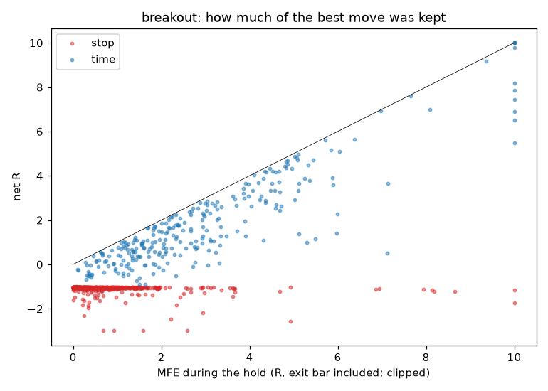

### After the exit (hindsight, NOT a longer-hold backtest)

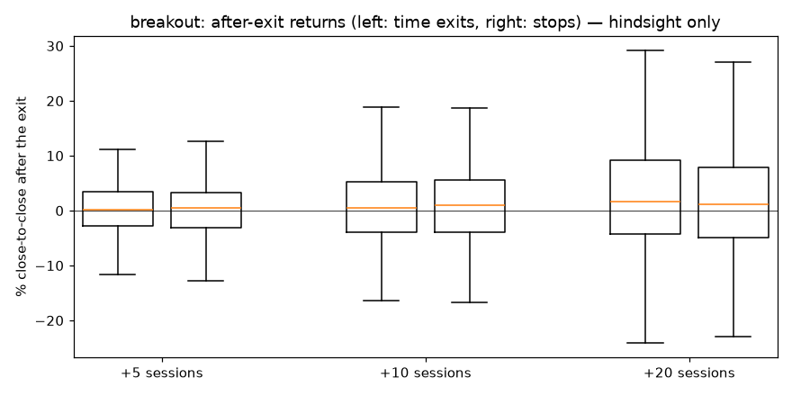

| Exit group | Horizon | n | Mean % | Median % | % positive | Close above entry % |
|---|---|---:|---:|---:|---:|---:|
| time | +5 | 274 | +0.20 % | +0.20 % | 52.9 | 82.8 |
| time | +10 | 273 | +0.24 % | +0.43 % | 53.5 | 78.0 |
| time | +20 | 269 | +2.28 % | +1.63 % | 56.9 | 77.0 |
| stop | +5 | 469 | +0.45 % | +0.41 % | 54.6 | 21.5 |
| stop | +10 | 465 | +1.09 % | +0.98 % | 55.5 | 29.5 |
| stop | +20 | 461 | +1.92 % | +1.14 % | 54.9 | 38.4 |
| top_decile_winners | +5 | 74 | -1.10 % | -0.98 % | 44.6 | 98.6 |
| top_decile_winners | +10 | 73 | -1.80 % | -1.31 % | 43.8 | 91.8 |
| top_decile_winners | +20 | 72 | +3.35 % | +2.83 % | 61.1 | 94.4 |

### Rare large winners

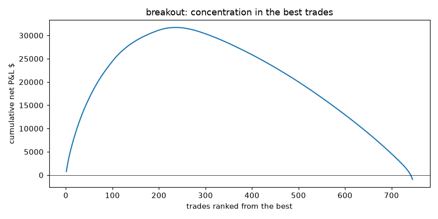

Closed net P&L $-924; top 5 $3,070, top 10 $5,307, top 20 $8,841. Without the top 10: $-6,230 (mean -0.132 R) — arithmetic only, not a re-simulated portfolio. Trades ≥ 3 R: 59 ($17,559), 100 % of them ended by the 20-day time exit; by exit year {2017: 1, 2018: 2, 2019: 2, 2020: 11, 2021: 11, 2022: 1, 2023: 6, 2024: 12, 2025: 7, 2026: 6}.

| Top 10 | Entry | Exit | Reason | Net P&L | R | MFE R |
|---|---|---|---|---:|---:|---:|
| PLTR | 2025-01-21 | 2025-02-19 | time | $773 | +9.77 | 13.20 |
| SNDK | 2026-04-10 | 2026-05-08 | time | $686 | +7.60 | 7.65 |
| WDC | 2025-09-08 | 2025-10-06 | time | $585 | +7.45 | 10.27 |
| VST | 2024-09-12 | 2024-10-10 | time | $526 | +7.84 | 11.42 |
| NVDA | 2023-05-01 | 2023-05-30 | time | $500 | +10.43 | 12.05 |
| PLTR | 2024-11-08 | 2024-12-09 | time | $486 | +10.81 | 16.34 |
| MU | 2026-04-09 | 2026-05-07 | time | $476 | +6.98 | 8.08 |
| NVDA | 2024-05-07 | 2024-06-05 | time | $467 | +6.92 | 6.97 |
| FCX | 2021-02-02 | 2021-03-03 | time | $405 | +6.89 | 11.20 |
| NTAP | 2026-09-14 | 2026-10-12 | time | $402 | +4.98 | 5.10 |

| Worst 15 | Entry | Exit | Reason | Net P&L | R |
|---|---|---|---|---:|---:|
| CPRT | 2018-09-07 | 2018-09-19 | stop | $-277 | -5.22 |
| TRIP | 2018-07-12 | 2018-08-02 | stop | $-231 | -3.52 |
| TER | 2026-04-10 | 2026-04-29 | stop | $-228 | -2.48 |
| PANW | 2024-02-08 | 2024-02-21 | stop | $-222 | -3.42 |
| ENPH | 2021-04-27 | 2021-04-28 | stop | $-186 | -2.31 |
| VST | 2025-01-22 | 2025-01-27 | stop | $-157 | -1.97 |
| CIEN | 2026-06-03 | 2026-06-04 | stop | $-155 | -1.83 |
| COIN | 2025-07-10 | 2025-08-01 | stop | $-152 | -2.59 |
| QCOM | 2021-02-02 | 2021-02-04 | stop | $-146 | -1.70 |
| PLTR | 2025-05-05 | 2025-05-06 | stop | $-135 | -1.58 |
| NEM | 2026-02-27 | 2026-03-03 | stop | $-134 | -1.51 |
| GNRC | 2021-07-22 | 2021-07-28 | stop | $-131 | -1.85 |
| ALGN | 2018-01-09 | 2018-02-06 | stop | $-124 | -1.27 |
| ALB | 2026-01-22 | 2026-01-30 | stop | $-122 | -2.20 |
| AMAT | 2021-01-20 | 2021-01-27 | stop | $-115 | -1.23 |

### Calendar years vs SPY (price only) and regimes

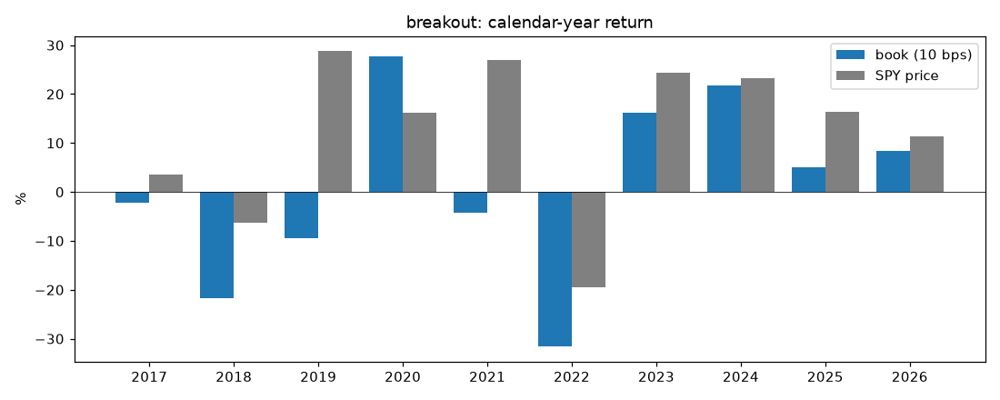

| Year | Book | Book $ | SPY price | Exits | Win % | Mean R |
|---|---:|---:|---:|---:|---:|---:|
| 2017 | -2.2 % | $-220 | +3.6 % | 11 | 27.3 | -0.231 |
| 2018 | -21.7 % | $-2,123 | -6.3 % | 72 | 25.0 | -0.476 |
| 2019 | -9.4 % | $-722 | +28.8 % | 81 | 30.9 | -0.300 |
| 2020 | +27.7 % | $1,921 | +16.2 % | 82 | 43.9 | +0.442 |
| 2021 | -4.3 % | $-382 | +27.0 % | 106 | 32.1 | -0.022 |
| 2022 | -31.6 % | $-2,679 | -19.5 % | 64 | 12.5 | -0.773 |
| 2023 | +16.3 % | $943 | +24.3 % | 66 | 37.9 | +0.202 |
| 2024 | +21.8 % | $1,472 | +23.3 % | 90 | 42.2 | +0.424 |
| 2025 | +5.0 % | $413 | +16.4 % | 88 | 27.3 | +0.152 |
| 2026 | +8.4 % | $726 | +11.4 % | 85 | 29.4 | -0.067 |

| Regime | Book | SPY price | Max DD inside | Invested % | Exits | Mean R | Stop share |
|---|---:|---:|---:|---:|---:|---:|---:|
| 2017 | -2.2 % | +19.4 % | -4.7 % | 84 | 11 | -0.231 | 64 % |
| 2018 | -21.7 % | -6.3 % | -25.5 % | 53 | 72 | -0.476 | 69 % |
| 2019 | -9.4 % | +28.8 % | -18.3 % | 77 | 81 | -0.300 | 62 % |
| covid_crash | -9.0 % | -33.8 % | -10.9 % | 24 | 5 | -0.599 | 80 % |
| covid_recovery | +20.0 % | +67.7 % | -15.4 % | 66 | 66 | +0.277 | 59 % |
| 2021 | -4.3 % | +27.0 % | -17.4 % | 73 | 106 | -0.022 | 64 % |
| bear_2022 | -22.0 % | -24.9 % | -22.0 % | 31 | 46 | -0.688 | 85 % |
| rebound_2022 | +3.9 % | +28.4 % | -18.6 % | 69 | 61 | +0.086 | 62 % |
| 2023_2026 | +36.1 % | +66.0 % | -17.3 % | 63 | 286 | +0.126 | 61 % |

2018 by month: 1: +2.1 % (2/5 stops, $-20); 2: -8.5 % (9/10 stops, $-638); 3: -5.4 % (8/9 stops, $-440); 4: -5.9 % (7/7 stops, $-508); 5: +1.4 % (3/3 stops, $-185); 6: +2.6 % (2/6 stops, $388); 7: -1.4 % (1/4 stops, $120); 8: +1.5 % (4/10 stops, $24); 9: -1.1 % (3/5 stops, $-178); 10: -6.3 % (8/10 stops, $-457); 11: +0.0 % (0/0 stops, $0); 12: -2.4 % (3/3 stops, $-185)

2022 by month: 1: -8.6 % (10/10 stops, $-709); 2: +1.1 % (0/1 stops, $278); 3: -3.6 % (3/3 stops, $-240); 4: -2.2 % (6/9 stops, $-207); 5: +0.0 % (0/0 stops, $0); 6: +0.0 % (0/0 stops, $0); 7: +2.5 % (5/5 stops, $-232); 8: -8.4 % (9/11 stops, $-179); 9: -4.7 % (6/7 stops, $-361); 10: -0.4 % (0/0 stops, $0); 11: -7.2 % (11/11 stops, $-555); 12: -5.1 % (6/7 stops, $-297)

### Capital deployment

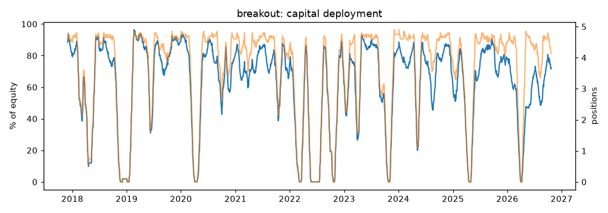

Invested on average 62.6 % of equity; 3.61 positions; fully in cash 15.7 % of sessions; all 5 slots full 50.3 %. Cash-limited entries 8. Skips: {'daily_entries': 745, 'ticker_open': 1689, 'positions': 23734, 'capital_or_risk': 10}.

Worst drawdowns: -47.7 % (2018-01-29 → trough 2023-04-12, recovered 2026-05-05); -17.3 % (2026-05-12 → trough 2026-09-01, recovered None); -4.8 % (2017-11-29 → trough 2018-01-02, recovered 2018-01-26); -2.4 % (2026-05-07 → trough 2026-05-07, recovered 2026-05-08); -1.2 % (2017-11-09 → trough 2017-11-09, recovered 2017-11-16)

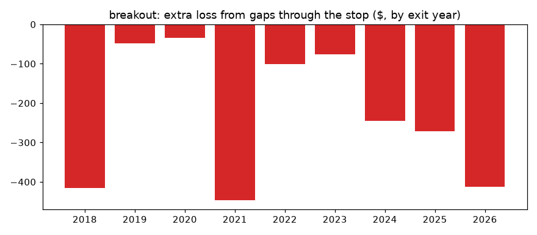

### By RS, risk size and SPY MA200 at the signal (correlations)

| Group | Value | Trades | Mean R | Win % | P&L |
|---|---|---:|---:|---:|---:|
| rs_bucket | 85-89 | 36 | -0.311 | 33.3 | $-860 |
| rs_bucket | 90-94 | 96 | -0.144 | 36.5 | $-1,027 |
| rs_bucket | 95-99 | 613 | +0.012 | 30.8 | $964 |
| risk_bucket | <2% | 28 | -0.539 | 7.1 | $-258 |
| risk_bucket | 2-4% | 312 | -0.095 | 29.5 | $-2,319 |
| risk_bucket | 4-6% | 259 | +0.035 | 32.4 | $242 |
| risk_bucket | 6-10% | 120 | +0.091 | 39.2 | $696 |
| risk_bucket | >10% | 26 | +0.290 | 42.3 | $715 |
| spy_ma200_signal | False | 92 | -0.307 | 27.2 | $-1,163 |
| spy_ma200_signal | True | 653 | +0.017 | 32.3 | $239 |
| cohort | 2017-2021 | 357 | -0.091 | 32.5 | $-2,078 |
| cohort | 2022-2026 | 388 | +0.039 | 30.9 | $1,154 |

## Retest (10 bps book)

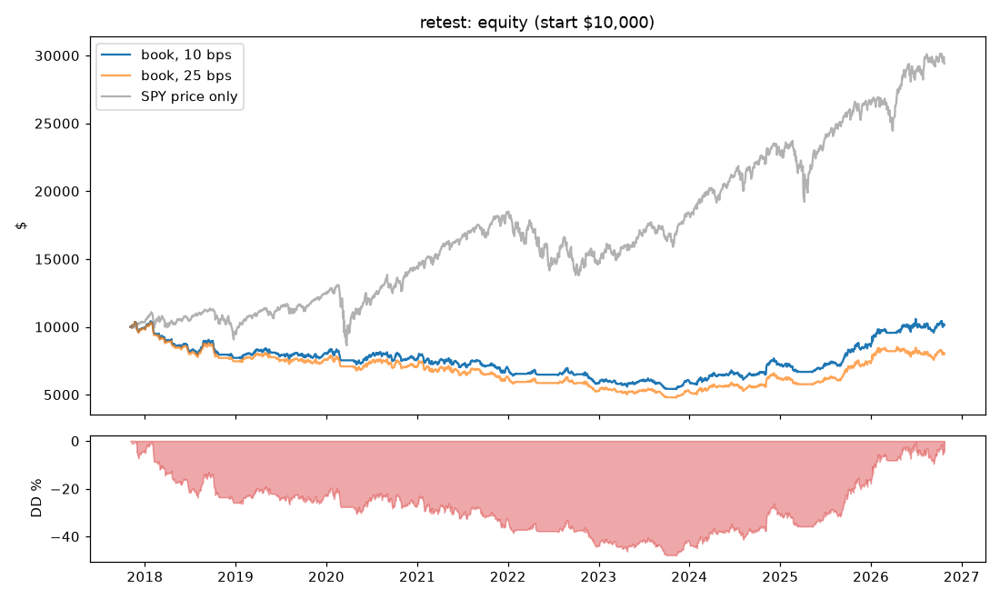

### Where the ten-year result comes from (exact $ decomposition)

| Component | $ |
|---|---:|
| gross price P&L, time exits | 20,925.21 |
| gross price P&L, stop exits at the planned stop | -18,744.66 |
| extra loss: gaps through the stop | -739.00 |
| costs on closed trades | -1,239.85 |
| open positions at the end (mark, after entry fee) | -75.46 |
| total = final equity - initial | 126.23 |

Closed trades 588: win rate 42.0 %, mean +0.035 R (avg win +1.37 R, avg loss -0.93 R), PF 1.01. Gross mean +0.067 R, costs 0.032 R per trade. Dividends a holder would have received but the engine does not credit: $415.

### Candidate funnel (hypothetical R only for comparison, never added to P&L)

| Set | Count | Mean R | Win % | PF (R) |
|---|---:|---:|---:|---:|
| all_candidates | 13609 | -0.009 | 42.2 | 0.98 |
| non_overlap_model_trades | 4532 | +0.015 | 41.8 | 1.03 |
| portfolio_closed | 588 | +0.035 | 42.0 | 1.06 |

| Portfolio decision | Count | Hypothetical mean R |
|---|---:|---:|
| capital_or_risk | 21 | +0.460 |
| daily_entries | 138 | +0.123 |
| entered | 592 | +0.035 |
| positions | 11640 | -0.021 |
| ticker_open | 1218 | +0.054 |

### Exits

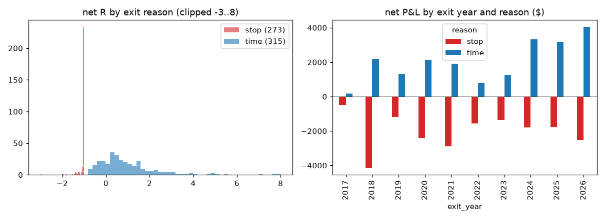

| Reason | Trades | Net P&L | Mean R | Win % | PF | MFE R (mean) |
|---|---:|---:|---:|---:|---:|---:|
| stop | 273 | $-20,084 | -1.077 | 0.0 | 0.00 | 0.52 |
| time | 315 | $20,285 | +0.998 | 78.4 | 14.00 | 1.80 |

- Stops on the entry day: 13. Stops that had been ≥ +1 R before the exit day: 41; ≥ +0.5 R: 99; never above entry: 16.
- Gaps through the stop: 33 trades, extra loss $-739 (mean -0.35 R each).
- Time exits: mean MFE 1.80 R, kept +1.00 R (gave back 0.81 R from the best intraday high).

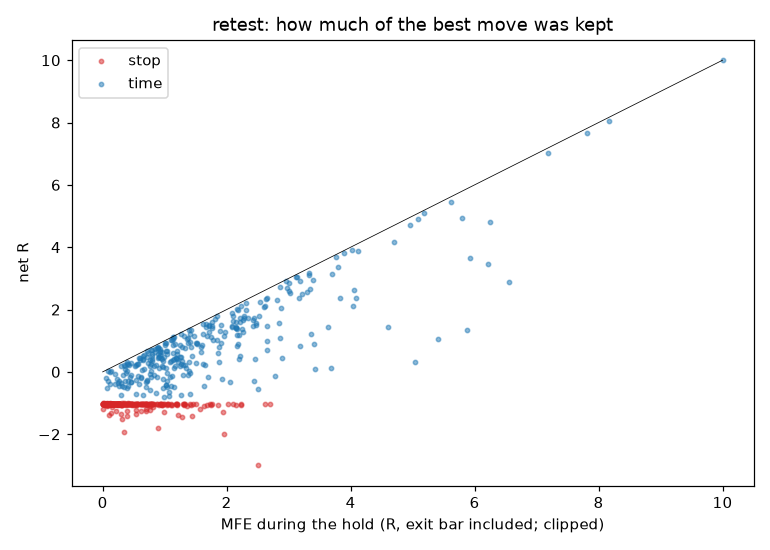

### After the exit (hindsight, NOT a longer-hold backtest)

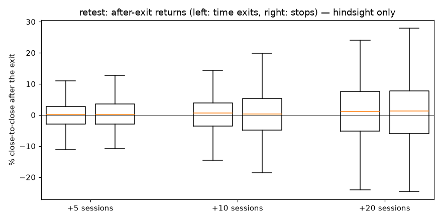

| Exit group | Horizon | n | Mean % | Median % | % positive | Close above entry % |
|---|---|---:|---:|---:|---:|---:|
| time | +5 | 314 | +0.04 % | +0.08 % | 50.6 | 75.8 |
| time | +10 | 313 | +0.79 % | +0.56 % | 54.3 | 76.0 |
| time | +20 | 311 | +1.53 % | +1.08 % | 55.3 | 69.1 |
| stop | +5 | 272 | +0.49 % | +0.20 % | 51.1 | 11.8 |
| stop | +10 | 270 | +0.56 % | +0.30 % | 51.5 | 20.4 |
| stop | +20 | 269 | +1.01 % | +1.25 % | 56.5 | 29.0 |
| top_decile_winners | +5 | 57 | +0.55 % | -0.20 % | 47.4 | 100.0 |
| top_decile_winners | +10 | 57 | +1.64 % | +0.68 % | 50.9 | 100.0 |
| top_decile_winners | +20 | 55 | +3.24 % | +2.00 % | 63.6 | 90.9 |

### Rare large winners

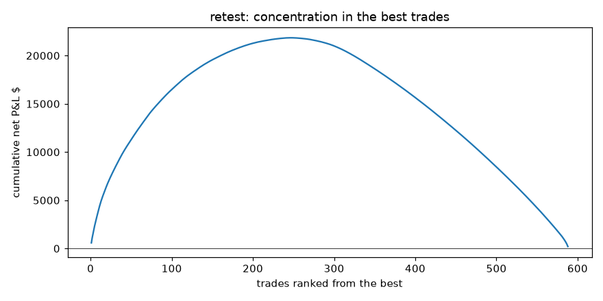

Closed net P&L $202; top 5 $2,347, top 10 $4,041, top 20 $6,535. Without the top 10: $-3,840 (mean -0.079 R) — arithmetic only, not a re-simulated portfolio. Trades ≥ 3 R: 23 ($6,939), 100 % of them ended by the 20-day time exit; by exit year {2018: 3, 2020: 1, 2021: 2, 2023: 4, 2024: 3, 2025: 4, 2026: 6}.

| Top 10 | Entry | Exit | Reason | Net P&L | R | MFE R |
|---|---|---|---|---:|---:|---:|
| AMD | 2018-08-02 | 2018-08-30 | time | $581 | +14.90 | 20.37 |
| PLTR | 2024-10-18 | 2024-11-15 | time | $520 | +8.06 | 8.18 |
| TER | 2025-12-29 | 2026-01-28 | time | $427 | +7.65 | 7.81 |
| STX | 2025-09-03 | 2025-10-01 | time | $427 | +7.02 | 7.18 |
| ALB | 2025-12-29 | 2026-01-28 | time | $393 | +4.81 | 6.24 |
| ILMN | 2026-09-03 | 2026-10-02 | time | $356 | +4.17 | 4.70 |
| FTNT | 2026-09-04 | 2026-10-05 | time | $349 | +3.90 | 4.02 |
| CAT | 2017-12-07 | 2018-01-08 | time | $337 | +5.47 | 5.61 |
| GLW | 2025-08-21 | 2025-09-19 | time | $328 | +4.90 | 5.09 |
| WDC | 2025-09-03 | 2025-10-01 | time | $324 | +5.10 | 5.18 |

| Worst 15 | Entry | Exit | Reason | Net P&L | R |
|---|---|---|---|---:|---:|
| PANW | 2024-01-29 | 2024-02-21 | stop | $-202 | -4.34 |
| DVA | 2026-07-13 | 2026-08-05 | stop | $-171 | -1.80 |
| CBOE | 2018-02-02 | 2018-02-06 | stop | $-141 | -1.40 |
| HII | 2026-01-20 | 2026-02-05 | stop | $-139 | -1.94 |
| KKR | 2024-07-19 | 2024-08-05 | stop | $-123 | -1.99 |
| NFLX | 2018-06-27 | 2018-07-17 | stop | $-123 | -1.53 |
| URI | 2018-01-09 | 2018-02-06 | stop | $-119 | -1.29 |
| DHI | 2018-01-18 | 2018-01-29 | stop | $-105 | -1.03 |
| NRG | 2018-01-09 | 2018-01-17 | stop | $-104 | -1.03 |
| DLTR | 2018-01-30 | 2018-02-02 | stop | $-103 | -1.03 |
| LRCX | 2017-11-06 | 2017-11-29 | stop | $-103 | -1.03 |
| HPE | 2026-06-09 | 2026-06-09 | stop | $-102 | -1.03 |
| MRNA | 2026-07-10 | 2026-07-10 | stop | $-101 | -1.03 |
| AMAT | 2017-11-06 | 2017-11-29 | stop | $-100 | -1.03 |
| PFG | 2026-09-21 | 2026-10-01 | stop | $-100 | -1.03 |

### Calendar years vs SPY (price only) and regimes

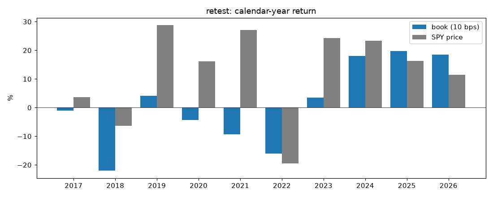

| Year | Book | Book $ | SPY price | Exits | Win % | Mean R |
|---|---:|---:|---:|---:|---:|---:|
| 2017 | -1.1 % | $-109 | +3.6 % | 7 | 28.6 | -0.496 |
| 2018 | -22.0 % | $-2,178 | -6.3 % | 75 | 26.7 | -0.210 |
| 2019 | +4.1 % | $313 | +28.8 % | 59 | 44.1 | +0.065 |
| 2020 | -4.3 % | $-346 | +16.2 % | 65 | 38.5 | -0.051 |
| 2021 | -9.3 % | $-718 | +27.0 % | 82 | 40.2 | -0.172 |
| 2022 | -16.0 % | $-1,115 | -19.5 % | 48 | 39.6 | -0.312 |
| 2023 | +3.4 % | $201 | +24.3 % | 59 | 42.4 | -0.034 |
| 2024 | +18.0 % | $1,091 | +23.3 % | 72 | 52.8 | +0.397 |
| 2025 | +19.7 % | $1,409 | +16.4 % | 64 | 46.9 | +0.311 |
| 2026 | +18.5 % | $1,579 | +11.4 % | 57 | 50.9 | +0.380 |

| Regime | Book | SPY price | Max DD inside | Invested % | Exits | Mean R | Stop share |
|---|---:|---:|---:|---:|---:|---:|---:|
| 2017 | -1.1 % | +19.4 % | -7.3 % | 76 | 7 | -0.496 | 71 % |
| 2018 | -22.0 % | -6.3 % | -25.9 % | 47 | 75 | -0.210 | 64 % |
| 2019 | +4.1 % | +28.8 % | -9.1 % | 66 | 59 | +0.065 | 27 % |
| covid_crash | -8.1 % | -33.8 % | -8.7 % | 16 | 6 | -1.102 | 100 % |
| covid_recovery | +2.0 % | +67.7 % | -8.4 % | 52 | 50 | +0.014 | 50 % |
| 2021 | -9.3 % | +27.0 % | -17.3 % | 58 | 82 | -0.172 | 51 % |
| bear_2022 | -6.5 % | -24.9 % | -8.1 % | 24 | 34 | -0.092 | 44 % |
| rebound_2022 | -6.1 % | +28.4 % | -16.0 % | 57 | 52 | -0.227 | 52 % |
| 2023_2026 | +65.7 % | +66.0 % | -13.3 % | 51 | 214 | +0.318 | 41 % |

2018 by month: 1: +4.2 % (2/7 stops, $191); 2: -9.1 % (6/8 stops, $-370); 3: -4.0 % (7/8 stops, $-530); 4: -3.0 % (4/5 stops, $-267); 5: -1.4 % (3/4 stops, $-249); 6: -4.7 % (6/11 stops, $-216); 7: -1.9 % (2/4 stops, $-147); 8: +9.5 % (3/9 stops, $677); 9: +1.0 % (3/4 stops, $-150); 10: -10.6 % (9/12 stops, $-668); 11: +0.0 % (0/0 stops, $0); 12: -3.0 % (3/3 stops, $-238)

2022 by month: 1: -6.7 % (4/8 stops, $-167); 2: +0.6 % (0/2 stops, $103); 3: +0.6 % (0/0 stops, $0); 4: -1.4 % (4/9 stops, $6); 5: -0.1 % (1/1 stops, $-67); 6: +0.0 % (0/0 stops, $0); 7: +2.2 % (0/0 stops, $0); 8: +2.0 % (3/7 stops, $93); 9: -4.3 % (3/6 stops, $-74); 10: +1.4 % (0/1 stops, $13); 11: -5.2 % (5/7 stops, $-312); 12: -5.8 % (6/7 stops, $-372)

### Capital deployment

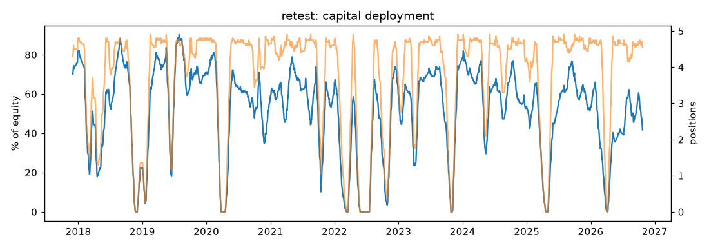

Invested on average 51.7 % of equity; 3.74 positions; fully in cash 12.8 % of sessions; all 5 slots full 56.1 %. Cash-limited entries 0. Skips: {'daily_entries': 138, 'ticker_open': 1218, 'positions': 11640, 'capital_or_risk': 21}.

Worst drawdowns: -48.0 % (2018-01-24 → trough 2023-11-09, recovered 2026-06-30); -9.6 % (2026-07-01 → trough 2026-09-10, recovered None); -7.3 % (2017-11-22 → trough 2017-12-06, recovered 2018-01-23); -1.2 % (2017-11-09 → trough 2017-11-09, recovered 2017-11-10); -1.0 % (2017-11-15 → trough 2017-11-15, recovered 2017-11-16)

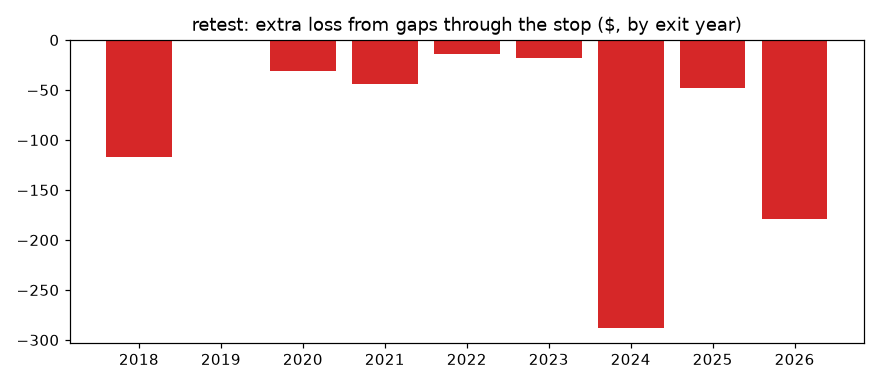

### By RS, risk size and SPY MA200 at the signal (correlations)

| Group | Value | Trades | Mean R | Win % | P&L |
|---|---|---:|---:|---:|---:|
| rs_bucket | 85-89 | 33 | +0.070 | 51.5 | $192 |
| rs_bucket | 90-94 | 112 | -0.012 | 42.9 | $55 |
| rs_bucket | 95-99 | 443 | +0.044 | 41.1 | $-46 |
| risk_bucket | <2% | 2 | +0.742 | 50.0 | $40 |
| risk_bucket | 2-4% | 31 | +0.731 | 38.7 | $1,043 |
| risk_bucket | 4-6% | 201 | -0.090 | 34.8 | $-1,516 |
| risk_bucket | 6-10% | 275 | -0.041 | 41.5 | $-1,150 |
| risk_bucket | >10% | 79 | +0.323 | 63.3 | $1,784 |
| spy_ma200_signal | False | 64 | +0.019 | 46.9 | $124 |
| spy_ma200_signal | True | 524 | +0.037 | 41.4 | $78 |
| cohort | 2017-2021 | 293 | -0.111 | 37.2 | $-3,373 |
| cohort | 2022-2026 | 295 | +0.179 | 46.8 | $3,575 |

## Data coverage and limitations

- Coverage: {"breakout": {"tickers_ever_member": 726, "tickers_with_prices": 609, "tickers_ever_member_without_prices": 117, "candidates": 26928, "candidates_open_at_data_end": 126, "candidates_window_incomplete": 275, "portfolio_skips_missing_prices": 0, "closed_trades": 745, "post_exit_window_missing": {"5": 2, "10": 7, "20": 15}, "closed_trades_with_dividend": 91}, "retest": {"tickers_ever_member": 726, "tickers_with_prices": 609, "tickers_ever_member_without_prices": 117, "candidates": 13609, "candidates_open_at_data_end": 94, "candidates_window_incomplete": 184, "portfolio_skips_missing_prices": 0, "closed_trades": 588, "post_exit_window_missing": {"5": 2, "10": 5, "20": 8}, "closed_trades_with_dividend": 101}}
- OHLC bars cannot tell whether the exit-day high came before a stop; MFE including the exit bar is an upper bound. Entry-day stops are filled at the stop price (engine rule).
- Prices are split-adjusted, not dividend-adjusted (`auto_adjust=False`). The engine credits no dividends and no cash interest; SPY comparisons are price only.
- Former members without price history cannot be traded in the backtest (see coverage).
- Post-exit returns are hindsight. They do not show that a longer hold is better: a different hold changes slots, capital and later choices, and would need its own pre-registered full replay.
- All group splits are descriptive correlations on data already examined, not proof of cause.
