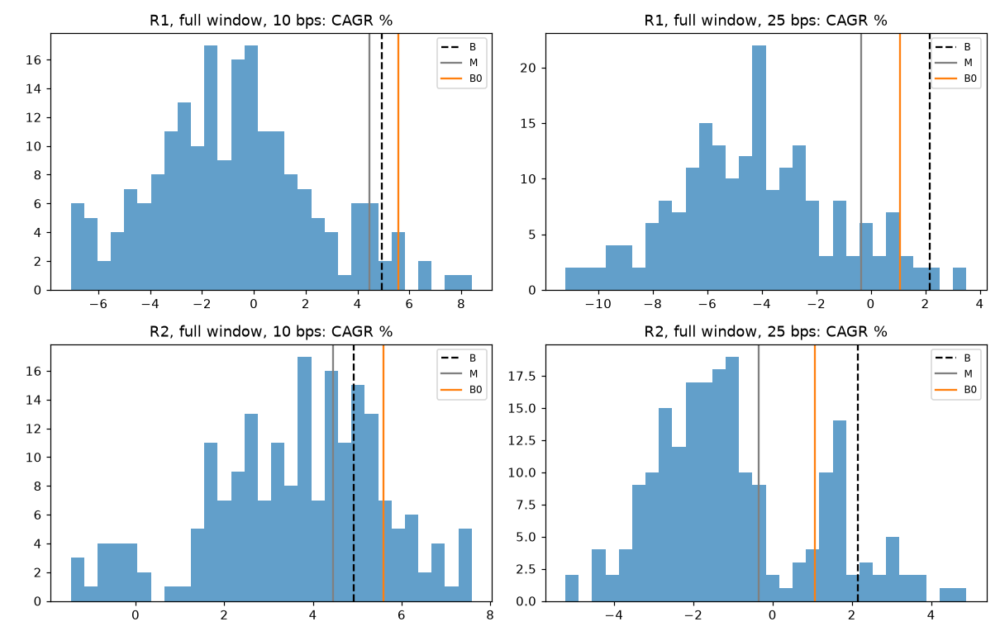
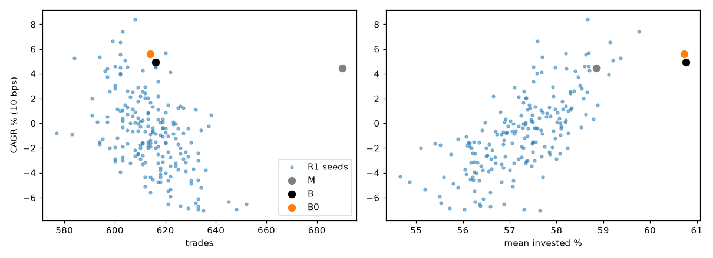
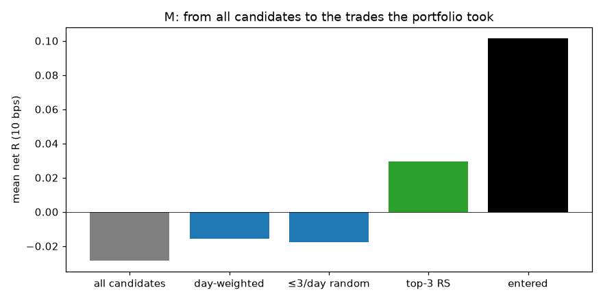

# Breakout + MA200 — Turnover & Selection Audit (exploratory)

Pre-registration: `research/turnover_selection/PREREG_TURNOVER_SELECTION.md` (committed before the run). M and B are exactly PR #23's. The 2017–2021 history misses many former index members (20.6 % of PIT member-days in 2017 without a price): **nothing here is independent confirmation**. Research Breakout buys at the next open, not like `trader.py`.

Reproduction of PR #23 (M and B, 3 windows × 2 costs): {'M full 10': 'exact', 'M full 25': 'exact', 'M y2017_2021 10': 'exact', 'M y2017_2021 25': 'exact', 'M y2022_2026 10': 'exact', 'M y2022_2026 25': 'exact', 'B full 10': 'exact', 'B full 25': 'exact', 'B y2017_2021 10': 'exact', 'B y2017_2021 25': 'exact', 'B y2022_2026 10': 'exact', 'B y2022_2026 25': 'exact'}

## Verdict

**B does NOT show a convincing advantage beyond turnover reduction: do not implement B**

| Criterion | Result |
|---|---|
| B CAGR > R1 p90 at 10 and 25 (full) | yes |
| B PF > R1 p80 at 10 and 25 (full) | yes |
| B max DD not > 3 pt deeper than R1 median (full 10) | yes |
| extension effect B - B0 > 0 at 10 and 25 (full) | no |

## 1. Where B's advantage comes from

| Book | Window | bps | Return | CAGR | Max DD | PF | Trades | Turnover/yr | Invested % |
|---|---|---|---:|---:|---:|---:|---:|---:|---:|
| M | full | 10 | +47.8 % | +4.46 % | -32.7 % | 1.143 | 690 | 27.9× | 58.9 |
| M | full | 25 | -3.1 % | -0.35 % | -42.5 % | 0.980 | 686 | 26.9× | 58.7 |
| M | y2017_2021 | 10 | -13.4 % | -3.40 % | -31.8 % | 0.899 | 335 | 28.6× | 64.1 |
| M | y2017_2021 | 25 | -25.6 % | -6.87 % | -37.1 % | 0.818 | 334 | 28.5× | 64.3 |
| M | y2022_2026 | 10 | +60.0 % | +10.28 % | -19.9 % | 1.250 | 361 | 27.2× | 54.3 |
| M | y2022_2026 | 25 | +41.7 % | +7.52 % | -22.0 % | 1.202 | 360 | 27.0× | 54.4 |
| B | full | 10 | +53.9 % | +4.92 % | -34.4 % | 1.157 | 616 | 24.7× | 60.8 |
| B | full | 25 | +21.0 % | +2.15 % | -40.2 % | 1.059 | 617 | 24.6× | 60.8 |
| B | y2017_2021 | 10 | -11.1 % | -2.78 % | -28.6 % | 0.911 | 307 | 26.5× | 66.2 |
| B | y2017_2021 | 25 | -22.5 % | -5.96 % | -33.8 % | 0.834 | 306 | 26.3× | 66.1 |
| B | y2022_2026 | 10 | +75.6 % | +12.43 % | -20.7 % | 1.362 | 313 | 23.5× | 55.8 |
| B | y2022_2026 | 25 | +49.8 % | +8.78 % | -22.9 % | 1.239 | 314 | 23.4× | 56.1 |
| B0 | full | 10 | +62.9 % | +5.59 % | -35.6 % | 1.198 | 614 | 24.6× | 60.7 |
| B0 | full | 25 | +10.0 % | +1.07 % | -46.9 % | 1.030 | 616 | 24.5× | 60.1 |
| B0 | y2017_2021 | 10 | -19.3 % | -5.04 % | -35.6 % | 0.844 | 306 | 26.4× | 66.2 |
| B0 | y2017_2021 | 25 | -32.6 % | -9.07 % | -40.6 % | 0.742 | 306 | 26.1× | 65.6 |
| B0 | y2022_2026 | 10 | +91.8 % | +14.52 % | -20.1 % | 1.426 | 313 | 23.6× | 55.9 |
| B0 | y2022_2026 | 25 | +72.0 % | +11.96 % | -21.4 % | 1.343 | 313 | 23.4× | 55.9 |

B0 = B's exit dates (slots held as long as in B) with M's day-20 price for every runner. `B0 − M` = slot / turnover / composition effect; `B − B0` = price effect of extending runners.

| Window | bps | B − M ($) | B0 − M ($) | B − B0 ($) |
|---|---|---:|---:|---:|
| full | 10 | 604 | 1,503 | -899 |
| full | 25 | 2,410 | 1,311 | 1,099 |
| y2017_2021 | 10 | 231 | -596 | 827 |
| y2017_2021 | 25 | 309 | -701 | 1,010 |
| y2022_2026 | 10 | 1,554 | 3,174 | -1,620 |
| y2022_2026 | 25 | 817 | 3,036 | -2,219 |

Exact split of profit_B − profit_M, full|10:

| Part | $ | Σ R | n |
|---|---:|---:|---:|
| identical trades (sizing only) | -772 | -0.0 | 371 |
| same entry, different exit (runners) | 208 | +5.7 | 64 |
| trades only in B | -1,610 | -26.1 | 179 |
| trades only in M (subtracted) | 2,258 | +18.5 | 251 |
| open positions at the end | 520 | — | — |
| total (profit B - profit M) | 604 | — | — |

Exact split of profit_B − profit_M, full|25:

| Part | $ | Σ R | n |
|---|---:|---:|---:|
| identical trades (sizing only) | -1,113 | -0.0 | 364 |
| same entry, different exit (runners) | 1,750 | +17.2 | 58 |
| trades only in B | 661 | -3.4 | 192 |
| trades only in M (subtracted) | 1,036 | +16.7 | 259 |
| open positions at the end | 75 | — | — |
| total (profit B - profit M) | 2,410 | — | — |

Exact split of profit_B − profit_M, y2017_2021|10:

| Part | $ | Σ R | n |
|---|---:|---:|---:|
| identical trades (sizing only) | -321 | -0.0 | 192 |
| same entry, different exit (runners) | 1,040 | +17.2 | 30 |
| trades only in B | -1,245 | -25.4 | 80 |
| trades only in M (subtracted) | 750 | +10.6 | 108 |
| open positions at the end | 7 | — | — |
| total (profit B - profit M) | 231 | — | — |

Exact split of profit_B − profit_M, y2017_2021|25:

| Part | $ | Σ R | n |
|---|---:|---:|---:|
| identical trades (sizing only) | -371 | -0.0 | 191 |
| same entry, different exit (runners) | 1,013 | +17.1 | 30 |
| trades only in B | -1,559 | -32.2 | 80 |
| trades only in M (subtracted) | 1,217 | +19.0 | 108 |
| open positions at the end | 9 | — | — |
| total (profit B - profit M) | 309 | — | — |

Exact split of profit_B − profit_M, y2022_2026|10:

| Part | $ | Σ R | n |
|---|---:|---:|---:|
| identical trades (sizing only) | -604 | +0.0 | 179 |
| same entry, different exit (runners) | 51 | -5.9 | 32 |
| trades only in B | 267 | +8.7 | 100 |
| trades only in M (subtracted) | 1,880 | +7.1 | 145 |
| open positions at the end | -39 | — | — |
| total (profit B - profit M) | 1,554 | — | — |

Exact split of profit_B − profit_M, y2022_2026|25:

| Part | $ | Σ R | n |
|---|---:|---:|---:|
| identical trades (sizing only) | -583 | -0.0 | 180 |
| same entry, different exit (runners) | -550 | -9.5 | 33 |
| trades only in B | -993 | -8.1 | 99 |
| trades only in M (subtracted) | 2,415 | +20.2 | 143 |
| open positions at the end | 528 | — | — |
| total (profit B - profit M) | 817 | — | — |

## 2. B against random controls (200 seeds each, full sequential replays)

R1: each M candidate dropped with probability q = 0.8725 (calibrated on seeds 1001–1020 to B's 616 trades). R2: 2934 random time exits extended with B's trailing exit (no +2 R condition).

| Control | Window | bps | Metric | p10 | p50 | p80 | p90 | B | B percentile |
|---|---|---|---|---:|---:|---:|---:|---:|---:|
| R1 | full | 10 | cagr_pct | -4.64 | -0.83 | 1.52 | 3.94 | 4.92 | 95 |
| R1 | full | 10 | max_dd_pct | -51.44 | -39.39 | -30.69 | -27.23 | -34.42 | 66 |
| R1 | full | 10 | profit_factor | 0.84 | 0.96 | 1.04 | 1.12 | 1.16 | 95 |
| R1 | full | 10 | return_pct | -34.70 | -7.17 | 14.47 | 41.48 | 53.88 | 95 |
| R1 | full | 10 | trades | 600.00 | 614.00 | 624.00 | 630.00 | 616.00 | 55 |
| R1 | full | 10 | turnover_per_year | 23.79 | 24.33 | 24.73 | 24.94 | 24.68 | 76 |
| R1 | full | 10 | invested_pct | 56.14 | 57.33 | 58.08 | 58.46 | 60.76 | 100 |
| R1 | full | 25 | cagr_pct | -7.89 | -4.30 | -1.97 | -0.02 | 2.15 | 99 |
| R1 | full | 25 | max_dd_pct | -61.36 | -49.85 | -41.17 | -34.36 | -40.19 | 82 |
| R1 | full | 25 | profit_factor | 0.75 | 0.85 | 0.93 | 0.99 | 1.06 | 98 |
| R1 | full | 25 | return_pct | -52.17 | -32.57 | -16.36 | -0.21 | 21.03 | 99 |
| R1 | full | 25 | trades | 599.90 | 614.00 | 623.00 | 630.00 | 617.00 | 59 |
| R1 | full | 25 | turnover_per_year | 23.46 | 23.97 | 24.38 | 24.54 | 24.60 | 91 |
| R1 | full | 25 | invested_pct | 55.53 | 56.81 | 57.53 | 58.01 | 60.82 | 100 |
| R1 | y2017_2021 | 10 | cagr_pct | -8.41 | -3.94 | 0.26 | 2.53 | -2.78 | 57 |
| R1 | y2017_2021 | 10 | max_dd_pct | -40.03 | -28.92 | -22.39 | -18.47 | -28.62 | 51 |
| R1 | y2017_2021 | 10 | profit_factor | 0.73 | 0.85 | 0.98 | 1.06 | 0.91 | 62 |
| R1 | y2017_2021 | 10 | return_pct | -30.59 | -15.39 | 1.07 | 10.96 | -11.07 | 57 |
| R1 | y2017_2021 | 10 | trades | 285.00 | 296.00 | 303.00 | 306.10 | 307.00 | 90 |
| R1 | y2017_2021 | 10 | turnover_per_year | 24.68 | 25.54 | 26.12 | 26.38 | 26.45 | 92 |
| R1 | y2017_2021 | 10 | invested_pct | 61.39 | 62.94 | 63.70 | 64.17 | 66.18 | 100 |
| R1 | y2017_2021 | 25 | cagr_pct | -11.78 | -7.51 | -3.42 | -1.27 | -5.96 | 61 |
| R1 | y2017_2021 | 25 | max_dd_pct | -46.48 | -36.09 | -28.81 | -25.55 | -33.83 | 62 |
| R1 | y2017_2021 | 25 | profit_factor | 0.65 | 0.76 | 0.87 | 0.95 | 0.83 | 70 |
| R1 | y2017_2021 | 25 | return_pct | -40.61 | -27.74 | -13.48 | -5.17 | -22.55 | 61 |
| R1 | y2017_2021 | 25 | trades | 285.00 | 296.00 | 303.00 | 306.10 | 306.00 | 88 |
| R1 | y2017_2021 | 25 | turnover_per_year | 24.44 | 25.32 | 25.87 | 26.10 | 26.30 | 94 |
| R1 | y2017_2021 | 25 | invested_pct | 61.13 | 62.75 | 63.50 | 63.90 | 66.10 | 100 |
| R1 | y2022_2026 | 10 | cagr_pct | -3.34 | 2.30 | 5.90 | 7.69 | 12.43 | 98 |
| R1 | y2022_2026 | 10 | max_dd_pct | -30.31 | -22.78 | -19.07 | -17.81 | -20.75 | 67 |
| R1 | y2022_2026 | 10 | profit_factor | 0.89 | 1.05 | 1.17 | 1.23 | 1.36 | 96 |
| R1 | y2022_2026 | 10 | return_pct | -15.05 | 11.55 | 31.69 | 42.72 | 75.56 | 98 |
| R1 | y2022_2026 | 10 | trades | 310.00 | 321.00 | 328.00 | 332.00 | 313.00 | 16 |
| R1 | y2022_2026 | 10 | turnover_per_year | 22.54 | 23.43 | 24.04 | 24.40 | 23.54 | 56 |
| R1 | y2022_2026 | 10 | invested_pct | 51.62 | 52.87 | 53.58 | 54.06 | 55.81 | 100 |
| R1 | y2022_2026 | 25 | cagr_pct | -6.76 | -1.01 | 2.37 | 4.41 | 8.78 | 99 |
| R1 | y2022_2026 | 25 | max_dd_pct | -35.60 | -26.36 | -22.06 | -20.12 | -22.86 | 74 |
| R1 | y2022_2026 | 25 | profit_factor | 0.79 | 0.95 | 1.06 | 1.11 | 1.24 | 97 |
| R1 | y2022_2026 | 25 | return_pct | -28.56 | -4.76 | 11.89 | 23.05 | 49.82 | 99 |
| R1 | y2022_2026 | 25 | trades | 309.00 | 321.00 | 327.00 | 332.00 | 314.00 | 21 |
| R1 | y2022_2026 | 25 | turnover_per_year | 22.15 | 23.00 | 23.61 | 23.89 | 23.40 | 72 |
| R1 | y2022_2026 | 25 | invested_pct | 51.59 | 52.68 | 53.40 | 53.83 | 56.14 | 100 |
| R2 | full | 10 | cagr_pct | 1.33 | 3.84 | 5.23 | 5.99 | 4.92 | 72 |
| R2 | full | 10 | max_dd_pct | -41.94 | -35.97 | -32.87 | -31.63 | -34.42 | 64 |
| R2 | full | 10 | profit_factor | 1.03 | 1.12 | 1.16 | 1.19 | 1.16 | 74 |
| R2 | full | 10 | return_pct | 12.58 | 40.26 | 57.97 | 68.46 | 53.88 | 72 |
| R2 | full | 10 | trades | 645.00 | 660.00 | 668.00 | 671.10 | 616.00 | 0 |
| R2 | full | 10 | turnover_per_year | 25.74 | 26.44 | 26.84 | 27.00 | 24.68 | 0 |
| R2 | full | 10 | invested_pct | 58.69 | 59.21 | 59.57 | 59.71 | 60.76 | 100 |
| R2 | full | 25 | cagr_pct | -3.22 | -1.33 | 1.27 | 1.81 | 2.15 | 92 |
| R2 | full | 25 | max_dd_pct | -51.16 | -45.64 | -41.51 | -39.39 | -40.19 | 85 |
| R2 | full | 25 | profit_factor | 0.90 | 0.95 | 1.03 | 1.05 | 1.06 | 92 |
| R2 | full | 25 | return_pct | -25.42 | -11.31 | 12.03 | 17.47 | 21.03 | 92 |
| R2 | full | 25 | trades | 644.90 | 659.00 | 666.00 | 671.00 | 617.00 | 0 |
| R2 | full | 25 | turnover_per_year | 25.42 | 25.91 | 26.31 | 26.51 | 24.60 | 0 |
| R2 | full | 25 | invested_pct | 58.33 | 58.96 | 59.35 | 59.51 | 60.82 | 100 |
| R2 | y2017_2021 | 10 | cagr_pct | -6.95 | -4.17 | -2.74 | -1.96 | -2.78 | 80 |
| R2 | y2017_2021 | 10 | max_dd_pct | -36.72 | -32.64 | -29.76 | -28.87 | -28.62 | 92 |
| R2 | y2017_2021 | 10 | profit_factor | 0.81 | 0.87 | 0.91 | 0.93 | 0.91 | 79 |
| R2 | y2017_2021 | 10 | return_pct | -25.89 | -16.24 | -10.91 | -7.92 | -11.07 | 80 |
| R2 | y2017_2021 | 10 | trades | 314.00 | 322.00 | 327.00 | 330.00 | 307.00 | 2 |
| R2 | y2017_2021 | 10 | turnover_per_year | 26.84 | 27.52 | 28.02 | 28.33 | 26.45 | 4 |
| R2 | y2017_2021 | 10 | invested_pct | 63.89 | 64.52 | 64.88 | 65.11 | 66.18 | 100 |
| R2 | y2017_2021 | 25 | cagr_pct | -10.44 | -8.04 | -6.27 | -5.45 | -5.96 | 82 |
| R2 | y2017_2021 | 25 | max_dd_pct | -41.70 | -37.86 | -35.25 | -33.94 | -33.83 | 90 |
| R2 | y2017_2021 | 25 | profit_factor | 0.73 | 0.78 | 0.83 | 0.85 | 0.83 | 82 |
| R2 | y2017_2021 | 25 | return_pct | -36.78 | -29.42 | -23.62 | -20.79 | -22.55 | 82 |
| R2 | y2017_2021 | 25 | trades | 313.90 | 321.00 | 327.00 | 329.00 | 306.00 | 2 |
| R2 | y2017_2021 | 25 | turnover_per_year | 26.69 | 27.34 | 27.81 | 28.09 | 26.30 | 2 |
| R2 | y2017_2021 | 25 | invested_pct | 63.79 | 64.43 | 64.86 | 65.08 | 66.10 | 100 |
| R2 | y2022_2026 | 10 | cagr_pct | 7.50 | 10.50 | 12.91 | 13.95 | 12.43 | 76 |
| R2 | y2022_2026 | 10 | max_dd_pct | -21.35 | -19.91 | -19.07 | -18.31 | -20.75 | 18 |
| R2 | y2022_2026 | 10 | profit_factor | 1.19 | 1.28 | 1.34 | 1.38 | 1.36 | 85 |
| R2 | y2022_2026 | 10 | return_pct | 41.52 | 61.55 | 79.13 | 87.22 | 75.56 | 76 |
| R2 | y2022_2026 | 10 | trades | 332.00 | 344.00 | 349.00 | 352.00 | 313.00 | 0 |
| R2 | y2022_2026 | 10 | turnover_per_year | 24.87 | 25.90 | 26.37 | 26.78 | 23.54 | 0 |
| R2 | y2022_2026 | 10 | invested_pct | 54.09 | 54.99 | 55.48 | 55.66 | 55.81 | 94 |
| R2 | y2022_2026 | 25 | cagr_pct | 3.29 | 6.92 | 9.60 | 10.50 | 8.78 | 72 |
| R2 | y2022_2026 | 25 | max_dd_pct | -23.48 | -21.97 | -20.93 | -20.19 | -22.86 | 18 |
| R2 | y2022_2026 | 25 | profit_factor | 1.08 | 1.18 | 1.25 | 1.28 | 1.24 | 77 |
| R2 | y2022_2026 | 25 | return_pct | 16.79 | 37.92 | 55.31 | 61.52 | 49.82 | 72 |
| R2 | y2022_2026 | 25 | trades | 333.00 | 344.00 | 350.00 | 352.10 | 314.00 | 0 |
| R2 | y2022_2026 | 25 | turnover_per_year | 24.56 | 25.53 | 26.08 | 26.33 | 23.40 | 0 |
| R2 | y2022_2026 | 25 | invested_pct | 54.10 | 54.88 | 55.43 | 55.61 | 56.14 | 100 |

RS-first vs random same-day order (M, full 10 bps, 200 seeds): random p10 / p50 / p90 return = -37.3 / -10.1 / +23.2 %; RS-first M = +47.8 % (percentile 98).

## 3. Why candidates average < 0 R and M's trades > 0 R

| Step | Mean net R (10 bps) | Effect |
|---|---:|---:|
| all candidates (24707) | -0.028 | |
| each day weighted equally (1469 days) | -0.016 | crowding +0.013 |
| ≤ 3 random per day | -0.018 | daily limit / crowding +0.011 |
| top 3 by RS per day | +0.029 | RS-first +0.047 |
| entered by the portfolio (686) | +0.101 | slots / held / sequence +0.072 |

Top-3-by-RS candidates by portfolio outcome: capital_or_risk: n=6, +0.077 R; entered: n=654, +0.135 R; positions: n=2648, -0.046 R; ticker_open: n=997, +0.160 R

All candidates by portfolio outcome: capital_or_risk: n=6, +0.077 R; daily_entries: n=662, +0.143 R; entered: n=686, +0.101 R; positions: n=21774, -0.048 R; ticker_open: n=1579, +0.108 R

By breadth (candidates that day) terciles (cuts 10, 20):

| Tercile | Candidates | Days | All | Day-weighted | ≤3 random | Top-3 RS | Entered (n) |
|---|---:|---:|---:|---:|---:|---:|---:|
| T1 | 3018 | 502 | +0.020 | +0.050 | +0.048 | +0.091 | +0.245 (264) |
| T2 | 7479 | 497 | -0.056 | -0.067 | -0.067 | -0.123 | -0.244 (199) |
| T3 | 14210 | 470 | -0.024 | -0.031 | -0.031 | +0.129 | +0.240 (223) |

By SPY 20-session return terciles (cuts 0.0179, 0.0356):

| Tercile | Candidates | Days | All | Day-weighted | ≤3 random | Top-3 RS | Entered (n) |
|---|---:|---:|---:|---:|---:|---:|---:|
| T1 | 7536 | 490 | -0.045 | -0.034 | -0.045 | -0.027 | +0.075 (313) |
| T2 | 8368 | 489 | -0.010 | +0.021 | +0.017 | +0.092 | +0.300 (200) |
| T3 | 8803 | 490 | -0.032 | -0.034 | -0.027 | +0.022 | -0.080 (173) |

## Context only: the completed research/breakout-causes run (base C, no MA200 — not mixed with M/B)

Source: research/results/breakout_causes/runs/2026-10-25T204323Z (branch research/breakout-causes). On C (10 bps): exact split signal quality +0.145 R / entry gap −0.037 / stop gap −0.045 / costs −0.048 = +0.014 R per executed trade (on the signal-close risk); after a time exit the stock beat SPY by +1.66 % at +20 sessions (90 % CI +0.59…+2.65) — on M the same figure is +0.60 % with a CI including 0 (PR #23). H2 there is identical to M and beat random removal of the same number of candidates (p95 +31.4 % vs +47.8 %); H3 (hold ≥ +1 R, 1 R trail, bar 60) on C was not supported (deeper drawdown).

